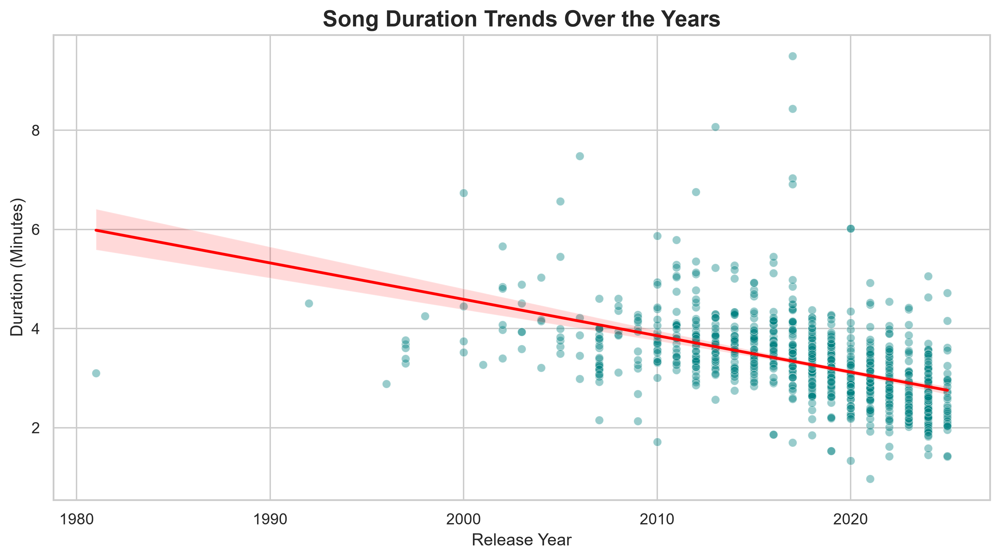
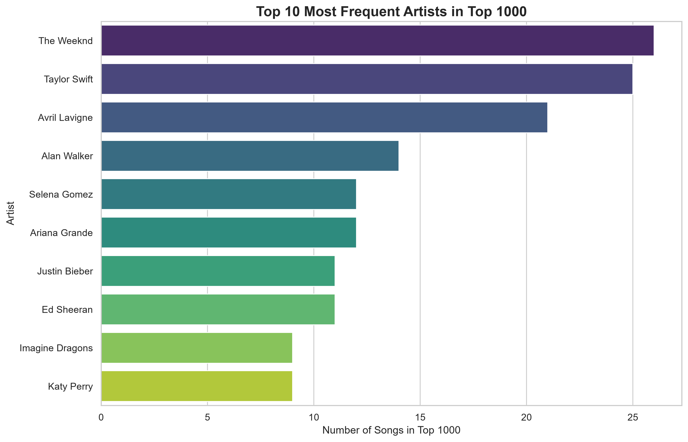
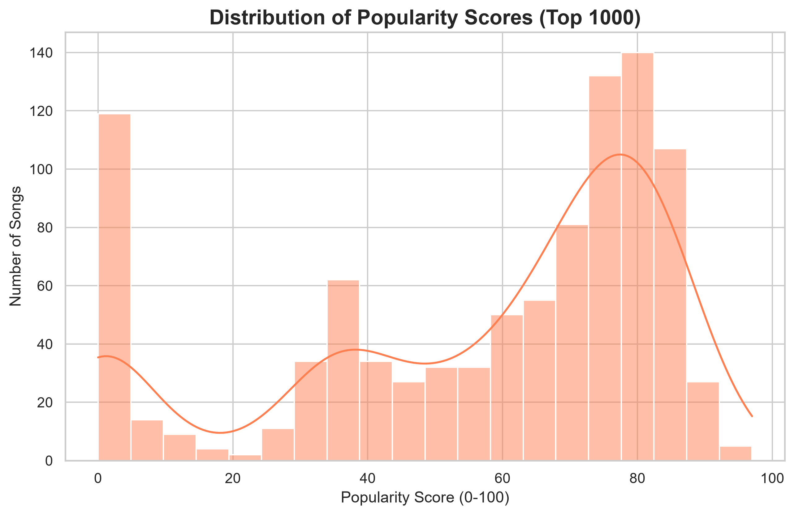

# 🎵 Spotify Top 1000 Tracks - Exploratory Data Analysis (EDA)

This project performs an Exploratory Data Analysis (EDA) on a dataset of the top 1000 Spotify tracks. The goal is to uncover trends in song duration, identify dominant artists, and understand the distribution of track popularity over time.

## 📊 Dataset Overview

The dataset (`data/raw/spotify_top_1000_tracks.csv`) contains the following key features:
- **track_name**: Name of the song
- **artist**: Primary artist of the track
- **album**: Name of the album
- **release_date**: Original release date of the track
- **popularity**: Spotify's popularity score (0-100)
- **duration_min**: Track length in minutes
- **spotify_url**: Link to the track on Spotify
- **id**: Unique Spotify track identifier

## 🔍 Key Insights & Visualizations

### 1. Are hit songs getting shorter over the years?
By plotting song duration against the release year, we can observe a clear downward trend. Modern hit songs are generally shorter than those released in previous decades, likely adapting to streaming algorithms and shorter listener attention spans.



### 2. Who are the Top 10 Most Frequent Artists?
This horizontal bar chart highlights the artists who dominate the top 1000 tracks. It reveals which musicians have the highest volume of highly popular songs in the dataset.



### 3. What is the Distribution of Popularity Scores?
Before analyzing correlations, it's important to understand the baseline distribution of the `popularity` metric. The histogram (with a KDE overlay) shows whether the "top 1000" tracks are heavily skewed toward maximum popularity or if there is a long tail of moderately popular songs.



## 🚀 Setup & Usage

To run this analysis locally, follow these steps:

1. **Clone the repository:**
   ```bash
   git clone https://github.com/devx099/spotify-eda.git
   cd spotify-eda
   ```

2. **Create a virtual environment (recommended)**
   ```bash
   python -m venv venv
   source venv/bin/activate  # For Windows, use: venv\Scripts\activate
   ```

3. **Install dependencies**
   ```bash
   pip install -r requirements.txt
   ```

4. **Run the Jupyter Notebook**
   ```bash
   jupyter notebook notebooks/spotify_analysis.ipynb
   ```

## 📂 Project Structure
```text
spotify-eda/
├── data/
│   └── raw/
│       └── spotify_top_1000_tracks.csv   # Original dataset
├── images/                               # Generated visualization outputs
│   ├── duration_trend.png
│   ├── popularity_distribution.png
│   └── top_artists_count.png
├── notebooks/
│   └── spotify_analysis.ipynb            # Main EDA notebook
├── requirements.txt                      # Python dependencies
└── README.md                             # Project documentation
```

## ⚠️ Limitations & Future Scope

Given the current dataset's size and limited columns, this analysis is restricted to high-level trends. To take this project further, future iterations could focus on **Data Enrichment**:

- **Spotify Web API Integration:** Using the track `id` column to fetch advanced audio features (`danceability`, `energy`, `valence`, `tempo`) via `spotipy` (Spotify's Python API). This would allow us to answer questions like *"Do highly energetic songs tend to be shorter?"*
- **Genre & Artist Metadata:** Merging external datasets to analyze genre-specific trends or artist career trajectories over time.
- **Predictive Modeling:** Once enriched with audio features, a regression model could be built to predict a track's baseline popularity.